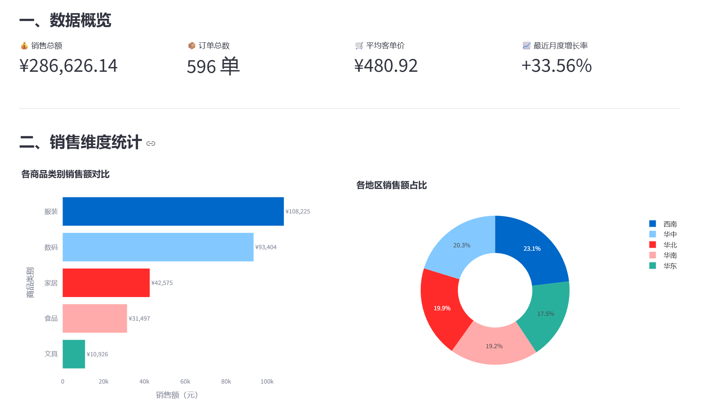
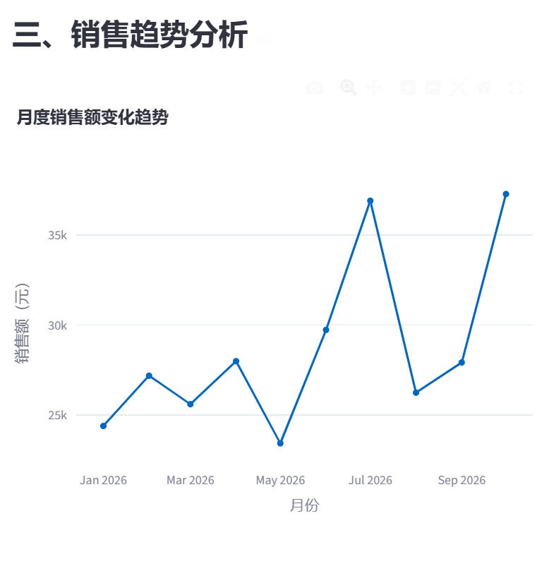
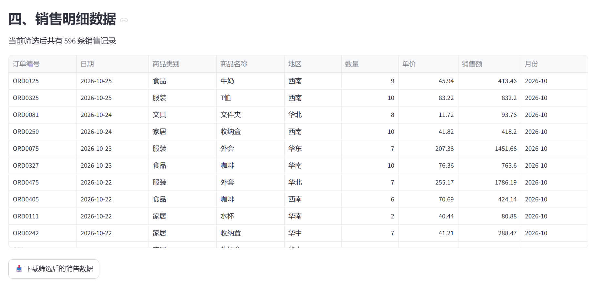
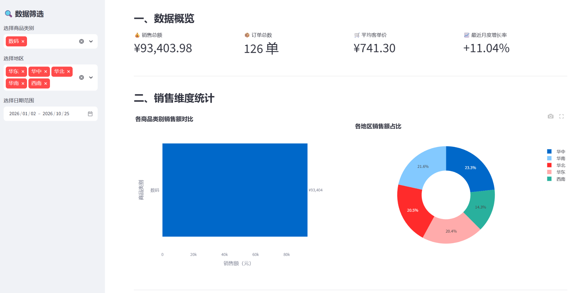
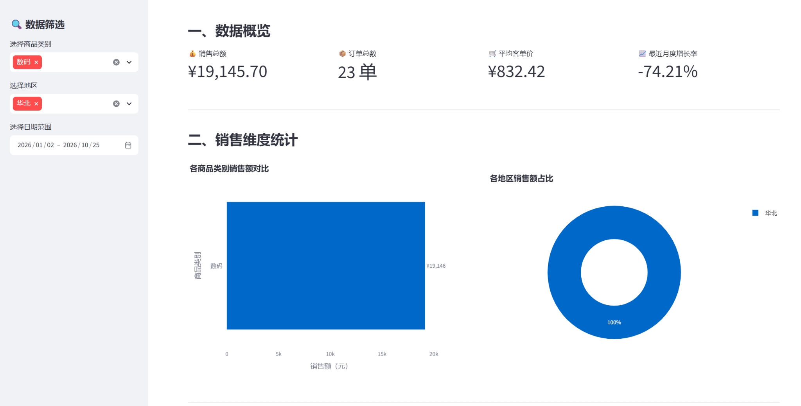
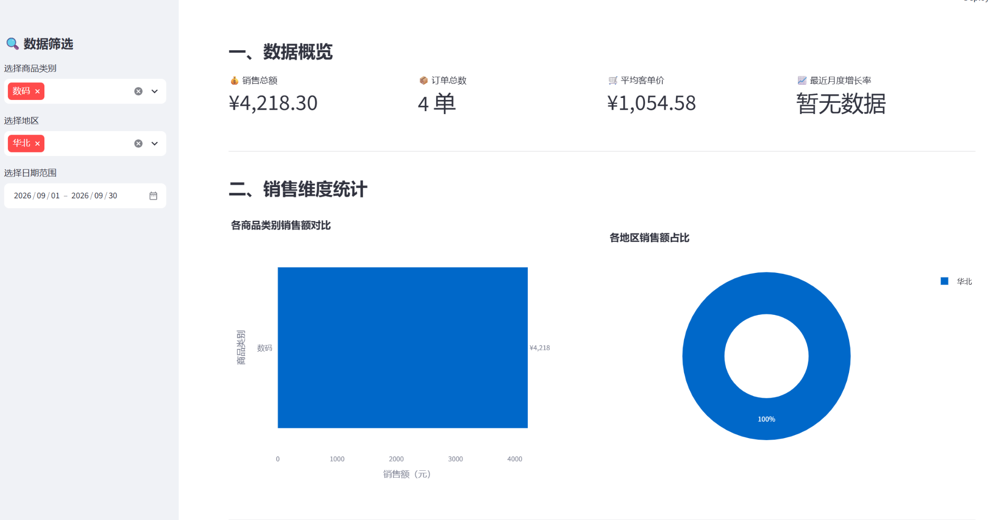
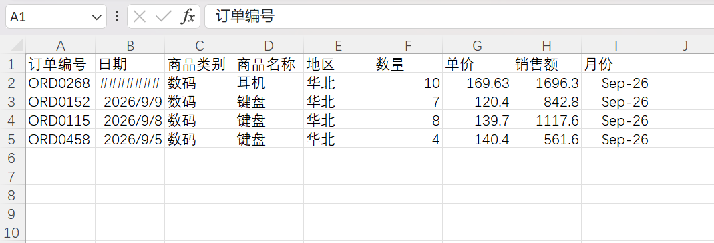

# 电商销售数据分析看板

## 一、项目简介

本项目是《实验2：数据看板的设计与实现》的实验作业，使用 Python、Streamlit、Pandas 和 Plotly，设计并实现一个电商销售数据分析看板。

项目通过生成模拟电商销售数据、清洗异常记录、统计销售指标以及绘制可视化图表，实现对销售情况的综合分析。

数据看板支持商品类别、销售地区和日期范围筛选，并能够下载筛选后的销售数据。

## 二、实验目的

1. 了解数据看板的基本组成和设计方法。
2. 掌握使用 Python 生成模拟数据的方法。
3. 学习使用 Pandas 进行数据读取、清洗和统计。
4. 学习使用 Plotly 绘制柱状图、环形图和折线图。
5. 学习使用 Streamlit 将数据指标与图表整合为网页。
6. 通过筛选与数据导出功能，提高对数据分析流程的理解。

## 三、开发环境

- 操作系统：Windows
- 编程语言：Python 3.14.2
- 开发工具：Visual Studio Code
- 数据处理：Pandas
- 数据可视化：Plotly
- 网页框架：Streamlit
- 版本管理：Git、GitHub

## 四、项目文件结构

```text
Ecommerce-Sales-Dashboard/
├── data/
│   ├── sales_raw.csv
│   └── sales_clean.csv
├── docs/
│   ├── screenshots/
│   │   ├── 01_dashboard_overview.png
│   │   ├── 02_sales_trend.png
│   │   ├── 03_sales_details.png
│   │   ├── 04_category_filter.png
│   │   ├── 05_region_filter.png
│   │   ├── 06_date_filter.png
│   │   └── 07_csv_export.png
│   └── experiment_report.md
├── app.py
├── clean_data.py
├── generate_data.py
├── requirements.txt
└── README.md
```

其中 `experiment_report.md` 为实验报告，将在最后阶段补充。

## 五、数据来源与处理

本项目使用 Python 生成模拟电商销售数据，不涉及真实企业的销售记录。

模拟数据包括订单编号、订单日期、商品类别、商品名称、地区、数量和单价等字段。

生成数据时，特意添加了部分异常记录与重复记录，用于练习 Pandas 数据清洗。

清洗过程主要包括：

1. 检查数据字段与缺失值。
2. 删除日期格式错误的记录。
3. 删除数量和单价不合理的记录。
4. 删除重复记录。
5. 计算订单销售额。
6. 提取月份信息，供趋势分析使用。

### 数据清洗结果

| 指标 | 数值 |
|---|---:|
| 原始销售记录 | 601 条 |
| 删除异常和重复记录 | 5 条 |
| 有效销售记录 | 596 条 |
| 有效销售总额 | 286,626.14 元 |

## 六、主要功能

### 1. 数据概览

展示以下核心指标：

- 销售总额
- 订单总数
- 平均客单价
- 最近月度销售增长率

### 2. 销售维度统计

使用横向柱状图对比不同商品类别的销售额。

使用环形图展示不同地区的销售额占比。

### 3. 销售趋势分析

通过折线图展示月度销售额变化，帮助观察不同月份的销售趋势。

### 4. 销售明细

以表格形式展示订单编号、日期、商品类别、商品名称、地区、数量、单价和销售额等信息。

### 5. 数据筛选与导出

支持以下功能：

- 商品类别筛选
- 销售地区筛选
- 日期范围筛选
- 多种条件组合筛选
- CSV 数据下载

筛选条件变化后，数据指标、统计图表和销售明细会同步更新。

## 七、程序运行方法

### 1. 安装依赖

在项目根目录打开终端，执行：

```bash
python -m pip install -r requirements.txt
```

### 2. 生成模拟数据

```bash
python generate_data.py
```

### 3. 清洗销售数据

```bash
python clean_data.py
```

### 4. 启动数据看板

```bash
python -m streamlit run app.py
```

启动成功后，在浏览器访问：

http://localhost:8501

即可查看数据看板。

## 八、实验运行截图

### 1. 数据看板概览



### 2. 月度销售趋势



### 3. 销售明细数据



### 4. 商品类别筛选

仅选择数码类别后，数据看板自动更新销售指标与图表。



### 5. 地区组合筛选

同时选择数码类别和华北地区后，销售指标与地区占比同步变化。



### 6. 日期范围筛选

筛选 2026 年 9 月的数码商品、华北地区订单，得到 4 条有效记录，销售总额为 4,218.30 元。



### 7. CSV 数据导出

将筛选后的 4 条销售记录导出为 CSV 文件，使用 Excel 打开后验证数据正确。



## 九、功能测试结果

| 测试内容 | 实际结果 |
|---|---|
| 原始数据生成 | 成功生成 601 条记录 |
| 数据清洗 | 保留 596 条有效记录 |
| 销售指标展示 | 正常 |
| 商品类别柱状图 | 正常 |
| 地区占比环形图 | 正常 |
| 月度趋势折线图 | 正常 |
| 商品类别筛选 | 通过 |
| 地区筛选 | 通过 |
| 日期范围筛选 | 通过 |
| CSV 数据导出 | 通过 |

## 十、实验收获

通过本次实验，我进一步熟悉了 Python 在数据处理和可视化方面的应用。

在数据准备阶段，我学习了如何生成模拟销售数据，并使用 Pandas 清洗缺失、异常和重复记录。

在数据看板制作阶段，我学习了通过 Plotly 绘制不同类型的统计图表，并使用 Streamlit 将数据指标、图表和明细表格整合到同一个网页中。

通过实际测试商品类别、地区和日期筛选功能，我认识到数据看板不仅能够展示数据，还能够根据用户的选择动态更新分析结果。

此外，我也进一步熟悉了 VS Code、Git 和 GitHub 的使用，为今后继续学习 Python 数据分析积累了实践经验。

## 十一、实验总结

本次实验完成了电商销售数据的生成、清洗、统计、可视化和交互分析，成功实现了一个基于 Streamlit 的数据看板。

通过运行测试，验证了数据展示、图表分析、条件筛选和 CSV 下载等功能，达到了本次实验的预期目标。